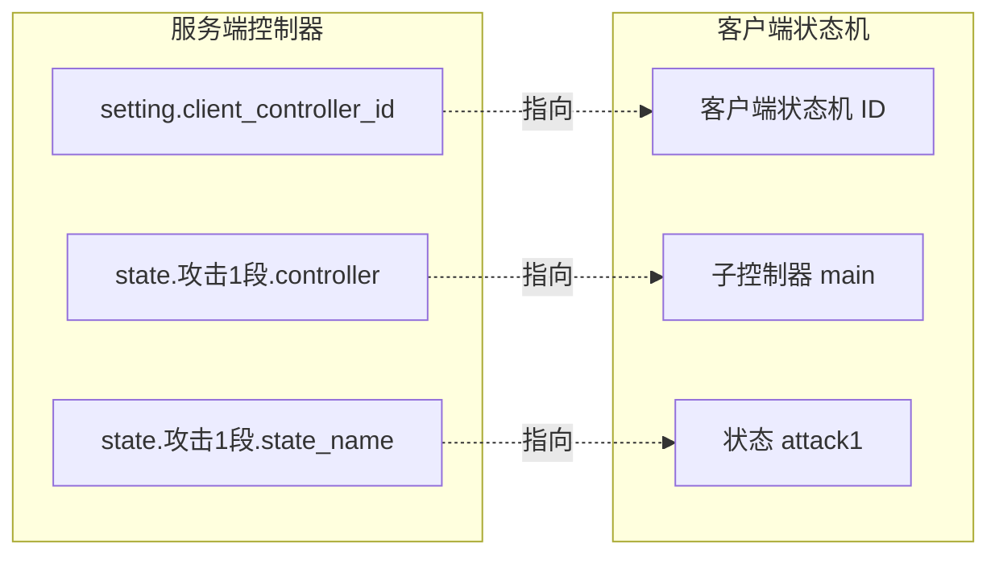
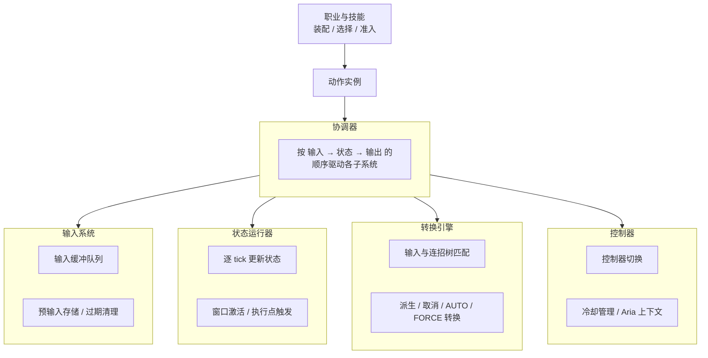
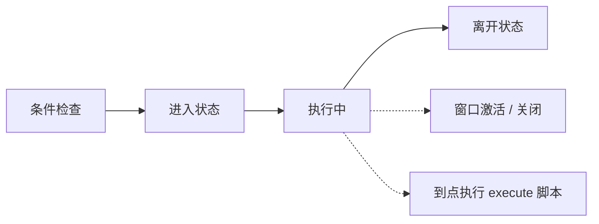
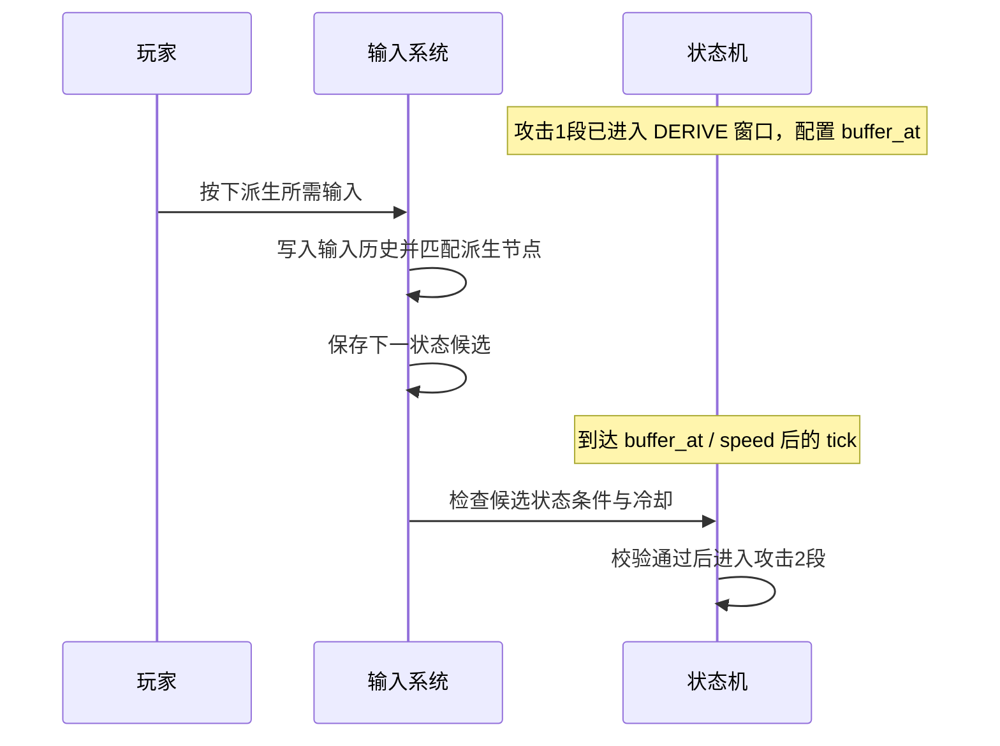

import { Callout } from 'fumadocs-ui/components/callout';
import { Step, Steps } from 'fumadocs-ui/components/steps';
import { Card, Cards } from 'fumadocs-ui/components/card';

# 说明

Chronos 是 ArcartX 生态中的**玩家动作引擎**。它把一套「动作游戏式」的战斗手感搬进 Minecraft：连招、派生、闪避无敌帧、霸体、蓄力、冷却……这些原本要写大量代码才能实现的机制，在 Chronos 里通过配置文件即可轻松完成。

- 这是一款**付费闭源插件**，需要购买授权后使用。
- 可在 [ArcartX 社区](https://arcartx.com/resources/arcartx-chronos-ke-luo-nuo-si.54/) 购买。

---

## Chronos 解决什么问题

原版 Minecraft 的攻击是「点一下、挥一下」，没有连段、没有前后摇、没有闪避判定。想做一个类魂、类动作游戏的战斗系统，你会立刻遇到一堆难题：

- 玩家连点三下鼠标，怎么区分这是「一段 → 二段 → 三段」而不是三次一段？
- 攻击动画播到一半，玩家能不能取消去闪避？哪一帧之后才允许？
- 闪避的哪几帧是无敌的？闪避成功后怎么接一记反击？
- 蓄力攒了多久，怎么换算成伤害？

Chronos 把这些都抽象成**状态机 + 连招树 + 时间窗口**。你只需要在 yml 里描述「有哪些动作、动作之间怎么衔接、每个动作的哪一段时间可以做什么」，剩下的输入识别、缓冲、判定、切换都由引擎完成。

**典型使用场景**：武器差异化的连招（单手剑三连、双手剑重击）、带无敌帧的翻滚闪避、蓄力斩、格挡反击、血量过低自动触发的处决动作等。

---

## 核心概念

配置前先了解这些概念：

| 概念                         | 说明                                                               |
|----------------------------|------------------------------------------------------------------|
| **控制器 (Controller)**       | 一整套动作配置，通常对应一把武器或一种形态。玩家同时只有一个生效控制器，系统另行保存基础控制器和临时覆盖栈            |
| **状态 (State)**             | 一个具体动作，比如「攻击1段」「闪避」「蓄力斩」。控制器由许多状态组成                              |
| **连招链 (Combo)**            | 一棵树，描述「在某个状态里、收到某种输入、就派生到哪个状态」                                   |
| **窗口 (Window)**            | 状态生命周期里的一段特殊时间，比如「派生窗口」「无敌帧」，决定这段时间内能做什么                         |
| **输入缓冲 (Input Buffer)**    | 保存短时间内的输入历史，供 AND / SEQUENCE 组合匹配；派生窗口内还可通过 `buffer_at` 暂存下一状态候选 |
| **职业 (Profession)**        | 限定玩家可以使用的控制器和技能，并提供本职业的控制器路由规则                                   |
| **技能槽 (Skill Slot)**       | 可配置的装配位置；从当前职业快照中查找技能。客户端按键触发时，槽位 ID 与注册按键 ID 对应；API 也可直接指定槽位    |
| **动作实例 (Action Instance)** | 一次技能释放的运行记录，包含冻结的职业、技能等级和可选目标结果                                  |

<Callout type="info">
可以这样类比：**控制器**是一把武器的招式书，**状态**是书里的每一招，**连招链**是招与招之间的连接线，**窗口**规定了每一招在什么时机能接什么、能不能被打断。
</Callout>

---

## 前后端如何配合

Chronos 是**服务端**逻辑，它不会自己播放动画。动画由**客户端**的 ArcartX 本体播放。所以任何一个 Chronos 动作，实际上横跨两套状态机：

- **服务端控制器**：Chronos 插件 `controllers/*.yml` 定义的状态机。负责识别输入、判断条件、管理冷却、决定进入哪个状态。
- **客户端状态机**：ArcartX 本体（Mod 端）负责的状态机，真正播放模型动画、原版动作、视觉效果。

两者靠三个字符串对接：

| 服务端字段                          | 指向客户端的                       |
|--------------------------------|------------------------------|
| `setting.client_controller_id` | 一个**客户端状态机**的 ID             |
| `state.<状态>.controller`        | 该客户端状态机下的**子控制器名**（如 `main`） |
| `state.<状态>.state_name`        | 子控制器下的**状态名**（如 `attack1`）   |

<Callout type="warn">
这三个字段都是字符串，需要与客户端资源里的名称一一对应。Chronos 在加载时会做交叉校验：**拼错只会打印 WARN 警告，不会阻断加载**，但玩家会「有逻辑没动画」。设置控制器后没看到动作，第一件事就是回来核对这三个名字。
</Callout>

---

## 引擎架构

职业和技能模块先解析装配、目标选择与外部资源准入，通过后创建动作实例。具体状态执行由输入系统、状态运行器、转换引擎和控制器系统协作完成：

| 子系统   | 职责                                      |
|-------|-----------------------------------------|
| 输入系统  | 维护输入缓冲队列、暂存预输入、清理过期输入                   |
| 状态运行器 | 管理状态生命周期，刻更新，激活当前窗口、触发执行点               |
| 转换引擎  | 把输入与连招树比对，执行派生、取消、AUTO 自动衔接与 FORCE 强制衔接 |
| 控制器   | 管理控制器切换、维护冷却时间、持有该玩家的 Aria 脚本上下文        |

---

## 状态生命周期

理解一个状态从进入到离开经历了什么，是配置窗口和执行点的前提：

<Callout type="info">
- **条件检查**：普通状态进入会检查 `conditions.expression`（Aria 布尔表达式）、`blocked_group` 和冷却。受控状态入口检查霸体并跳过这些校验；强制进入入口也跳过目标状态的条件与冷却校验。
- **进入状态**：初始化本次状态并触发 `PlayerEnterStateEvent`；若事件处理后仍是这个状态，再通知客户端播放对应动画。
- **执行中**：每 tick 推进时间线，按 `windows` 开关各窗口、按 `execute` 的 `at` 时刻执行脚本、持续判定派生与 FORCE 衔接。
- **离开状态**：自然结束、被派生、被打断、被强制清空都算离开，触发 `PlayerLeaveStateEvent`（与 Enter 严格成对）。正常结束流程可以处理 AUTO；打断或强制清空不会因 Leave 事件自动接出下一段。
</Callout>

---

## 输入缓冲机制

Chronos 分别维护输入历史和下一状态候选：输入历史用于 AND / SEQUENCE 组合匹配；下一状态候选用于在指定时刻衔接派生动作。

普通输入到达时会先写入输入历史。如果此时已有状态和连招节点，且处于 DERIVE 窗口，`buffer_at >= 0` 会把匹配到的派生节点保存为候选；到达 `buffer_at / speed` 后，在后续 tick 检查候选状态的条件与冷却，再尝试衔接。若当前状态先自然结束，也会尝试尚未处理的候选。`buffer_at: -1` 则在输入到达时直接尝试派生。

输入历史的容量和有效期由控制器的 `setting.input_buffer` 控制：`max_size` 限制数量，`lifetime` 限制保留时长（毫秒）。组合匹配只使用仍有效的历史输入。已选出的下一状态候选单独保存，不受 `lifetime` 再次计时淘汰。

<Callout type="info">
DERIVE 窗口打开前的输入可以作为后续组合匹配的历史，但窗口打开本身不会自动重放它，也不会自动生成下一状态候选。配置派生手感时，请同时核对输入匹配、DERIVE 窗口和 `buffer_at`。详见[服务端控制器](/docs/chronos/7_controller)。
</Callout>

---

> **官方 QQ 交流群：832063293**
