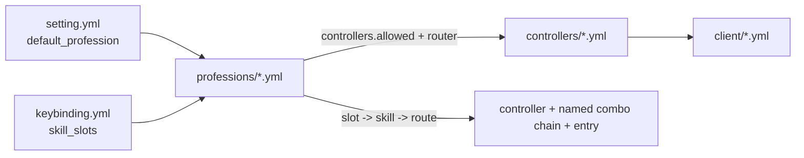

import { File, Folder, Files } from 'fumadocs-ui/components/files';
import { Callout } from 'fumadocs-ui/components/callout';

授权通过、云端业务加载后，`plugins/Chronos/` 的主要结构如下。首次未授权启动时可能只有授权配置：

<Files>
  <Folder name="Chronos" defaultOpen>
    <Folder name="client" />
    <Folder name="controllers" />
    <Folder name="professions">
      <File name="common.yml" />
    </Folder>
    <Folder name="migration-backups" />
    <File name="keybinding.yml" />
    <File name="setting.yml" />
    <File name="migration-state.yml" />
    <File name="license.yml" />
  </Folder>
</Files>

`migration-backups/` 与 `migration-state.yml` 只会在检测并处理旧格式时出现；全新安装不会为了占位而创建它们。

| 路径                    | 作用                                                            |
|-----------------------|---------------------------------------------------------------|
| `client/*.yml`        | 客户端动画状态机                                                      |
| `controllers/*.yml`   | 服务端控制器、状态、连招链和 execute                                        |
| `professions/*.yml`   | 职业配置；包含各职业允许的控制器、路由器、技能定义和默认装配。只读取此目录直接包含的 `.yml` 文件，不递归读取子目录 |
| `setting.yml`         | 只保存配置 schema 与默认职业                                            |
| `license.yml`         | 授权码 ID 与 KEY；修改后需重启服务器重新连接授权服务                                |
| `keybinding.yml`      | 注册客户端按键，并声明哪些按键 ID 是技能槽                                       |
| `migration-backups/*` | 旧格式迁移时保存的原始文件、哈希和完成标记                                         |
| `migration-state.yml` | 最近一次成功迁移的结果摘要                                                 |

<Callout type="warn">
新运行时不读取旧的 `default_controller`、`switch_by_main_hand` 或全局 `triggers`。
当 schema 小于 3 且检测到这些旧字段时，插件会先备份旧 `setting.yml`，再转换为新 `setting.yml` 和 `professions/common.yml`；
迁移失败会停止启用，不回退到旧逻辑。
</Callout>

## 文件之间的关系

控制器负责动作怎么运行；职业负责玩家当前可以使用哪些控制器、技能和槽位映射。职业等级、技能升级、解锁、资源和持久化需要由外部职业框架插件持有，Chronos 只消费快照。

